# Class Diagram

## Mermaid class diagram

```mermaid
classDiagram
    class User {
        +isSuperAdmin() bool
        +isBanned() bool
        +workspaces() BelongsToMany
        +belongsToWorkspace(Workspace) bool
        +settings() UserSetting
        +unreadMessagesCount() int
        +canManageFiles(User, Workspace) bool
    }

    class Workspace {
        +users() BelongsToMany
        +companyFiles() HasMany
        +canManageFiles(User, Workspace) bool
        +canViewFiles(User, Workspace) bool
        +canManageEquipment(User, Workspace) bool
    }

    class WorkspaceContext {
        +runFor(Workspace, callable)
        +current() Workspace
        +check() bool
        +id() int
    }

    class ResolveWorkspace {
        +handle(Request, Closure) Response
    }

    class DashboardController {
        +index(Request) InertiaResponse
    }

    class WorkspaceLandingController {
        +__invoke(Request) RedirectResponse|Response
    }

    class Equipment {
        +workspace() BelongsTo
        +category() BelongsTo
        +cover() BelongsTo
        +canManageFiles(User, Workspace) bool
        +canViewFiles(User, Workspace) bool
    }

    class EquipmentCategory {
        +workspace() BelongsTo
        +equipment() HasMany
    }

    class EquipmentController {
        +index(Request) InertiaResponse
        +store(Request) RedirectResponse
        +show(Request, Equipment) InertiaResponse
        +update(Request, Equipment) RedirectResponse
        +destroy(Request, Equipment) RedirectResponse
        +bulkDestroy(Request) RedirectResponse
        +liveRow(Request, Equipment) JsonResponse
    }

    class FileItem {
        +owner() MorphTo
        +creator() BelongsTo
        +parent() BelongsTo
        +children() HasMany
        +scopeForOwner(Builder, Model)
    }

    class FileOwner {
        <<interface>>
        +canManageFiles(User, Workspace) bool
        +canViewFiles(User, Workspace) bool
    }

    class HasFiles {
        <<trait>>
        +files() MorphMany
    }

    class BelongsToWorkspace {
        <<trait>>
        +bootBelongsToWorkspace()
    }

    class Conversation {
        +users() BelongsToMany
        +messages() HasMany
        +isParticipant(User) bool
        +unreadCountFor(User) int
    }

    class Message
    class ChatController {
        +index(Request) InertiaResponse
        +store(Request) JsonResponse
        +sendMessage(Request, Conversation) JsonResponse
        +markRead(Request, Conversation) JsonResponse
    }

    class MessageSent {
        <<ShouldBroadcast>>
        +broadcastOn() Channel[]
        +broadcastWith() array
    }

    class Module {
        +key
        +enabled
        +features
    }

    class WorkspaceModuleFeature {
        +enabled
        +features
    }

    class ModuleRegistry {
        +featureEnabled(string, string, Workspace) bool
        +featuresFor(Workspace) array
    }

    class EnsureModuleEnabled {
        +handle(Request, Closure, key) Response
    }

    class Role
    class Permission

    Authenticatable <|-- User
    FileOwner <|.. User
    FileOwner <|.. Workspace
    FileOwner <|.. Equipment
    HasFiles <.. User
    HasFiles <.. Workspace
    HasFiles <.. Equipment
    BelongsToWorkspace <.. Equipment
    BelongsToWorkspace <.. EquipmentCategory
    BelongsToWorkspace <.. FileItem

    User "*" -- "*" Workspace : workspace_user
    User "1" -- "*" FileItem : creates
    Workspace "1" -- "*" FileItem : scope
    FileItem "1" -- "*" FileItem : parent
    Workspace "1" -- "*" Equipment
    EquipmentCategory "1" -- "*" Equipment
    Equipment "1" -- "0..1" FileItem : cover
    Workspace "1" -- "*" WorkspaceModuleFeature
    Module "1" -- "*" WorkspaceModuleFeature

    ResolveWorkspace --> WorkspaceContext : activates/restores
    ResolveWorkspace --> Workspace : resolves
    ResolveWorkspace --> User : membership check
    DashboardController --> WorkspaceContext : reads current
    DashboardController --> Workspace : member/files stats
    DashboardController --> ModuleRegistry : widgets
    WorkspaceLandingController --> Workspace : accessible workspaces
    WorkspaceLandingController --> User : membership/settings

    EquipmentController --> Equipment : CRUD/query
    EquipmentController --> EquipmentCategory : validation/list
    EquipmentController --> FileItem : previews/documents
    EquipmentController --> ModuleRegistry : log feature
    EquipmentController --> ResourceChanged : broadcasts via trait

    ChatController --> Conversation : CRUD/query
    ChatController --> Message : create/query
    ChatController --> MessageSent : broadcasts
    Conversation "1" -- "*" Message
    Conversation "*" -- "*" User : conversation_user

    EnsureModuleEnabled --> ModuleRegistry : enabled check
    ModuleRegistry --> Module
    ModuleRegistry --> WorkspaceModuleFeature

    User --> Role : Spatie teams
    Role --> Permission
```

## Responsibilities

- `User` is authentication, profile, workspace membership, personal file ownership, chat participant, notification recipient and authorization subject.
- `Workspace` is the tenant, membership container, company file owner and workspace-specific permission/feature boundary.
- `ResolveWorkspace` resolves `{workspace}` from a slug, rejects inactive/non-member workspaces and activates `WorkspaceContext`/Spatie team scope.
- `DashboardController` loads workspace member/file/chat/widget data and renders `resources/js/Pages/Dashboard.vue` via Inertia.
- `EquipmentController` is the concrete reference CRUD implementation. It uses the workspace context, validates category IDs in the tenant, queries equipment/files and emits resource-change broadcasts.
- `FileItem` is polymorphic file/folder storage metadata and can belong to a user, workspace or another `FileOwner`.
- `ChatController`, `Conversation` and `Message` implement direct/group chat and broadcasts.
- `Module` and `WorkspaceModuleFeature` implement global and per-workspace feature state.
- Spatie `Role`/`Permission` classes provide team-scoped authorization.

## Inheritance and interfaces
- `User` extends Laravel's `Authenticatable`, implements `FileOwner`, `MustVerifyEmail`, `HasMedia` and `HasLocalePreference`.
- `Workspace` and `Equipment` implement `FileOwner`; `Workspace` and `Equipment` use `HasFiles`.
- `Equipment`, `EquipmentCategory` and `FileItem` use `BelongsToWorkspace`.
- `MessageSent` and `ResourceChanged` implement `ShouldBroadcast`.
- `DashboardWidgetRegistry` and module dashboard widgets are a registry/contract area; the concrete class is implemented and registered, but the property system is not involved.

## Uncertain relationships
- The diagram shows no property, branch, unit or lease classes because no such classes or migrations exist.
- Polymorphic `FileItem.owner_type/owner_id` is real for the implemented owner types, but a future `Building`/`Unit` relationship is only documented in comments and is not implemented.
- The team role model is evidence of workspace-scoped authorization, not evidence that a workspace is a branch.
- `Workspace` also implements file ownership, which is generic tenant infrastructure and can be distinguished from a property branch.

## Source references
- `app/Domains/Users/Models/User.php`
- `app/Domains/Workspaces/Models/Workspace.php`
- `app/Domains/Workspaces/Support/WorkspaceContext.php`
- `app/Domains/Workspaces/Http/Middleware/ResolveWorkspace.php`
- `app/Domains/Equipment/Models/Equipment.php`
- `app/Domains/EquipmentCategory/Models/EquipmentCategory.php`
- `app/Domains/Files/Models/FileItem.php`
- `app/Domains/Chat/Models/Conversation.php`
- `app/Domains/Chat/Http/Controllers/ChatController.php`
- `app/Domains/Modules/Models/Module.php`
- `app/Domains/Modules/Models/WorkspaceModuleFeature.php`
- `app/Domains/Modules/Services/ModuleRegistry.php`
- `app/Domains/Equipment/Http/Controllers/EquipmentController.php`
- `app/Support/Events/ResourceChanged.php`
- `app/Domains/Chat/Events/MessageSent.php`
