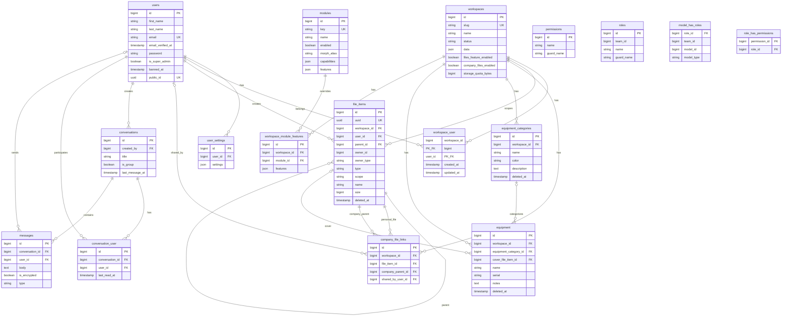

# Database Schema

## Scope and status

This repository uses one shared database/schema; workspaces are application-level tenants with `workspace_id` row filtering, not separate schemas or databases.

Evidence:
- `config/workspaces.php` explicitly says there is no schema/database-per-workspace and one database is shared.
- `app/Domains/Workspaces/Models/Concerns/BelongsToWorkspace.php:29-43` adds a global `workspace_id` scope and stamps creates with the active context.
- `app/Domains/Workspaces/Support/WorkspaceContext.php` activates a workspace for a request.

## Mermaid ER diagram

## Table list

### Authentication and account tables
- `users`: names, unique email, password, email verification, ban fields, public UUID, super-admin flag, two-factor and profile columns. Eloquent: `app/Domains/Users/Models/User.php`.
- `password_reset_tokens`: email primary key and reset token.
- `sessions`: PHP session storage and optional user id.
- `personal_access_tokens`: Sanctum API tokens, polymorphic tokenable owner.
- `two_factor_*` columns: Fortify fields added to `users`.
- `user_settings`: JSON preferences, last-workspace state and dashboard settings.

Evidence: `database/migrations/0001_01_01_000000_create_users_table.php`, `2026_04_09_214216_add_two_factor_columns_to_users_table.php`, `2026_04_09_214216_create_personal_access_tokens_table.php`, `2026_04_18...` and `app/Domains/Users/Models/User.php`.

### Authorization and multi-tenant roles
- `roles`, `permissions`, `role_has_permissions`.
- `model_has_roles` and `model_has_permissions` support polymorphic assignments.
- Spatie teams are enabled; `roles.team_id` and assignment pivot `team_id` scope roles to a workspace. `team_id` is nullable on roles, allowing platform-level role design while the user is platform-super-admin via `users.is_super_admin`, not a team role.

Evidence: `config/permission.php:118-129`, `database/migrations/2026_04_07_173421_create_permission_tables.php`, `app/Domains/Users/Models/User.php:128-142`, `app/Domains/Access/Models/Role.php`.

### Workspace and membership tables
- `workspaces`: slug, name, status, JSON data, file flags and quotas.
- `workspace_user`: composite membership key between workspace and user.
- `workspace_invitations`: implemented invitation records; inspect/confirm exact columns before relying on it.

Evidence: `database/migrations/2019_09_15_000010_create_workspaces_table.php`, `2026_04_16_195151_create_workspace_user_table.php`, `app/Domains/Workspaces/Models/Workspace.php`, and `app/Domains/Workspaces/Models/WorkspaceInvitation.php`.

### Module tables
- `modules`: platform-global registry, enabled flag, morph alias and JSON features/capabilities.
- `workspace_module_features`: per-workspace feature overrides; unique `(workspace_id, module_id)`.

Evidence: migrations `2026_05_30_030000_create_modules_table.php` and `2026_05_30_050000_create_workspace_module_features_table.php`.

### Chat tables
- `conversations`: direct/group conversation metadata and last-message timestamp.
- `conversation_user`: participants plus `last_read_at`; unique per participant/conversation.
- `messages`: belongs to conversation and optional sender; encryption/type flags.

Evidence: migrations `2026_04_19_100000...` through `100002...` and `app/Domains/Chat/Models/Conversation.php`.

### File tables
- `file_items`: workspace, uploader, polymorphic owner, parent folder, scope, type, name, MIME and size. It has soft deletes and a UUID.
- `company_file_links`: workspace, personal file, target company folder and sharing user. Unique `(workspace_id, file_item_id)`.
- Spatie `media` table stores physical media metadata and conversions.

Evidence: `database/migrations/2026_04_20_160207_create_file_items_table.php`, `2026_04_24_100002_create_company_file_links_table.php`, `2026_04_15_171046_create_media_table.php`, `app/Domains/Files/Models/FileItem.php`.

### Implemented demo/business-domain tables
- `equipment_categories`: workspace-scoped lookup; name, colour, description and soft delete.
- `equipment`: workspace-scoped equipment record; category and cover-file foreign keys; name, serial and notes.
- These are clearly implemented as starter-kit demo modules, not property-management entities.

Evidence: `database/migrations/2026_05_27_115000_create_equipment_categories_table.php`, `2026_05_27_120000_create_equipment_table.php`, `app/Domains/Equipment/Models/Equipment.php`, `app/Domains/EquipmentCategory/Models/EquipmentCategory.php`.

### Other implemented tables
The migration set also includes app settings, notifications, mail settings/templates/layouts, activity log, pulse, cache/jobs, backups and file-share tables. These are infrastructure or starter domains rather than property-domain entities.

## Important indexes
- Unique `workspaces.slug`, `users.email`, `equipment_categories`/`equipment` and chat uniqueness.
- Composite workspace indexes on `file_items`, equipment and categories.
- Permission team and morph indexes/pivot primary keys.
- `conversation_user` unique `(conversation_id,user_id)` and lookup `(user_id,conversation_id)`.
- PostgreSQL trigram/performance migrations may add search indexes; they must be inspected for exact final schema, but no property-specific migrations were identified in the available migration names.

## Property-management relevance
- **Implemented:** generic users, workspaces/tenants, memberships, workspace roles, files, activity log, chat and demo equipment/category CRUD.
- **Partially implemented:** workspaces can function as a generic tenant boundary, but the repository does not evidence that they are branches. No branch table or branch foreign key exists in the inspected migrations.
- **Not implemented:** properties, units, buildings, tenants/leases, rents, payments, invoices, maintenance requests or occupancy tables. The `Equipment` tables are demo assets and should not be interpreted as properties.
- **Potential mismatch:** comments use `equipment`, `company`, `Workspace`, and “tenant”; none establish a one-company/three-branch business model. A property implementation would require explicit branch/site tables and branch-scoped foreign keys plus branch authorization, not merely assuming three workspaces.
- **Uncertain:** whether `workspaces.status`, `workspace_user` and membership roles are intended to model branches. The code only proves tenant/membership behavior.

## Source references
- `database/migrations/`
- `config/workspaces.php`
- `config/permission.php`
- `app/Domains/Workspaces/Models/Concerns/BelongsToWorkspace.php`
- `app/Domains/Workspaces/Models/Workspace.php`
- `app/Domains/Users/Models/User.php`
- `app/Domains/Files/Models/FileItem.php`
- `app/Domains/Equipment/Models/Equipment.php`
- `app/Domains/EquipmentCategory/Models/EquipmentCategory.php`
