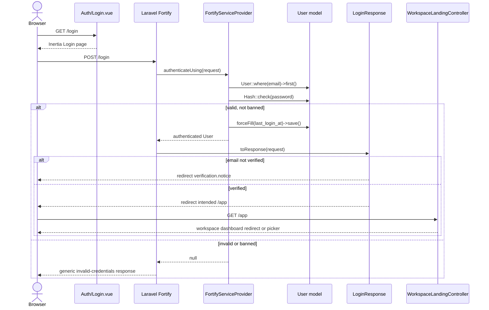
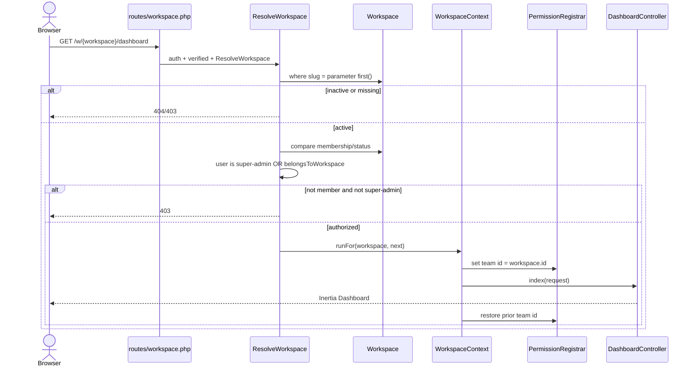
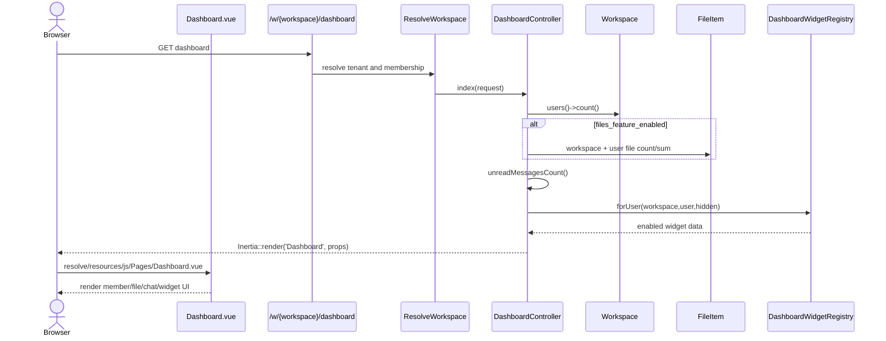
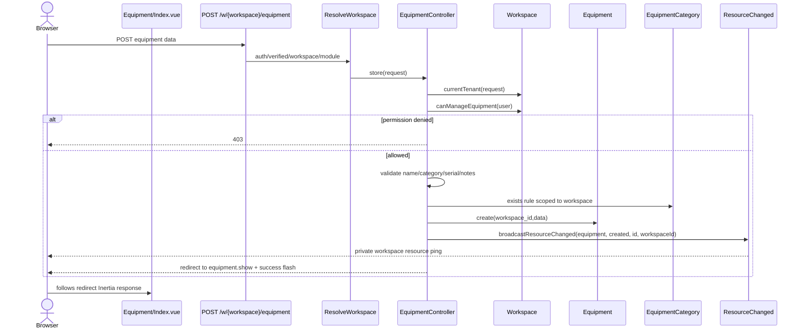
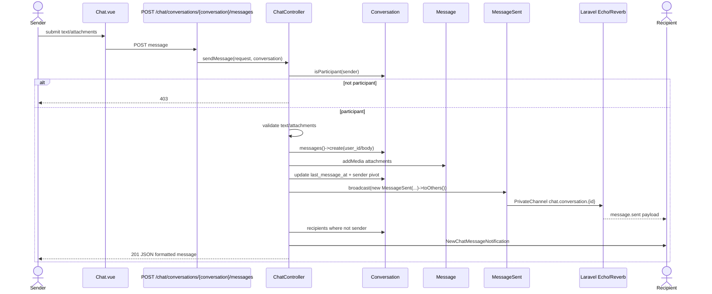
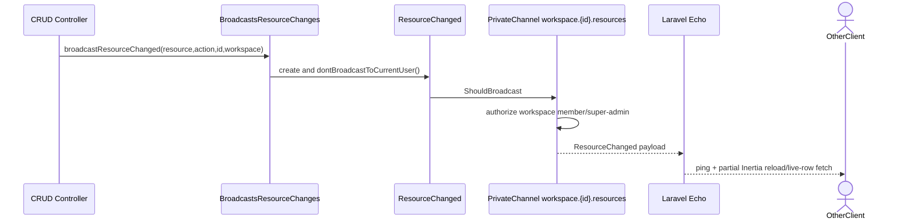

# Sequence Diagrams

## 1. Login and authentication

### Actual route and middleware
- Fortify `/login` handles the GET and POST routes registered by the package.
- Fortify login view: `FortifyServiceProvider::boot()` renders `resources/js/Pages/Auth/Login.vue`.
- `FortifyServiceProvider::authenticateUsing()` loads `User` by email, checks password and ban state, updates `last_login_at`, and returns the user.
- `LoginResponse::toResponse()` verifies invitations, checks email verification, then redirects to `/app`.
- `/app` is handled by `WorkspaceLandingController::__invoke()` and is behind `auth`, `verified`.

Evidence:
- `app/Domains/Auth/Providers/FortifyServiceProvider.php:34-81`
- `app/Domains/Auth/Http/Responses/LoginResponse.php:10-26`
- `routes/web.php:134-145`
- `app/Domains/Workspaces/Http/Controllers/WorkspaceLandingController.php:25-101`
- `resources/js/Pages/Auth/Login.vue`

## 2. Workspace resolution and access control

### Actual route shape
- Multi-tenant: `GET /w/{workspace}/dashboard` from `routes/workspace.php`, mounted in `bootstrap/app.php`.
- Middleware: `web`, `auth`, `verified`, `ResolveWorkspace`.
- Single-tenant: workspace routes are mounted at the root and use `BindDefaultWorkspace` instead.

Evidence:
- `bootstrap/app.php:36-52`
- `routes/workspace.php:39`
- `app/Domains/Workspaces/Http/Middleware/ResolveWorkspace.php:28-77`
- `app/Domains/Workspaces/Support/WorkspaceContext.php`
- `app/Domains/Workspaces/Models/Concerns/BelongsToWorkspace.php:29-43`

**Uncertainty:** `ResolveWorkspace` bypasses membership for `isSuperAdmin()` and allows any active workspace. It proves global support users, not branch semantics.

## 3. Dashboard loading

Evidence:
- `routes/workspace.php:39`
- `app/Domains/Workspaces/Http/Controllers/DashboardController.php:18-65`
- `app/Domains/Modules/Services/DashboardWidgetRegistry.php`
- `resources/js/app.ts:18-24`
- `resources/js/Pages/Dashboard.vue`

## 4. Representative CRUD: equipment create

This is the strongest implemented domain-like CRUD but remains a demo starter module.

Evidence:
- `routes/workspace.php:163-180`
- `app/Domains/Equipment/Http/Controllers/EquipmentController.php:120-133,621-653`
- `app/Domains/Workspaces/Models/Workspace.php:118-129`
- `app/Support/Concerns/BroadcastsResourceChanges.php:19-34`
- `app/Support/Events/ResourceChanged.php:32-69`
- `routes/channels.php:39-51`

## 5. Real-time notification/broadcast flow

### Chat message

Evidence:
- `routes/web.php:118-127`
- `app/Domains/Chat/Http/Controllers/ChatController.php:311-415`
- `app/Domains/Chat/Events/MessageSent.php:13-77`
- `routes/channels.php:13-15`
- `resources/js/Pages/Chat.vue`

### Workspace resource live updates

Evidence:
- `app/Support/Concerns/BroadcastsResourceChanges.php:19-34`
- `app/Support/Events/ResourceChanged.php:32-69`
- `routes/channels.php:39-51`
- Controllers such as `EquipmentController::store/update/destroy` call the trait.

## Frontend rendering
- `resources/js/app.ts` creates the Inertia/Vue application and resolves `resources/js/Pages/**/*.vue` via `import.meta.glob`, so an Inertia response maps to the named Vue page.
- `app/Http/Middleware/HandleInertiaRequests.php` shares auth, workspace, module, settings and other props.
- Inertia JSON/redirect responses drive normal Vue navigation; chat and live resource features also use Laravel Echo.

## Source references
- `routes/web.php`
- `routes/workspace.php`
- `bootstrap/app.php`
- `app/Domains/Auth/Providers/FortifyServiceProvider.php`
- `app/Domains/Auth/Http/Responses/LoginResponse.php`
- `app/Domains/Workspaces/Http/Middleware/ResolveWorkspace.php`
- `app/Domains/Workspaces/Http/Controllers/WorkspaceLandingController.php`
- `app/Domains/Workspaces/Http/Controllers/DashboardController.php`
- `app/Domains/Equipment/Http/Controllers/EquipmentController.php`
- `app/Domains/Chat/Http/Controllers/ChatController.php`
- `app/Support/Events/ResourceChanged.php`
- `routes/channels.php`
- `resources/js/app.ts`
